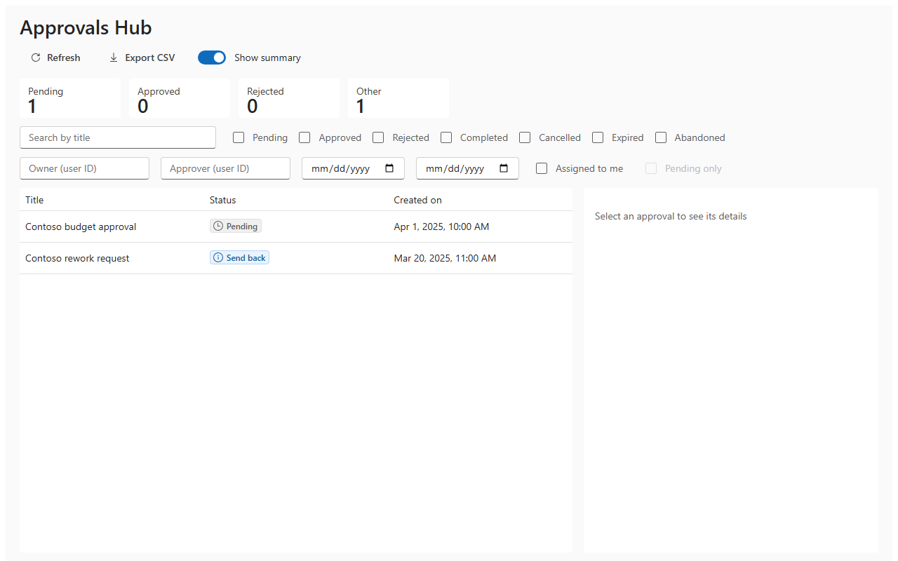
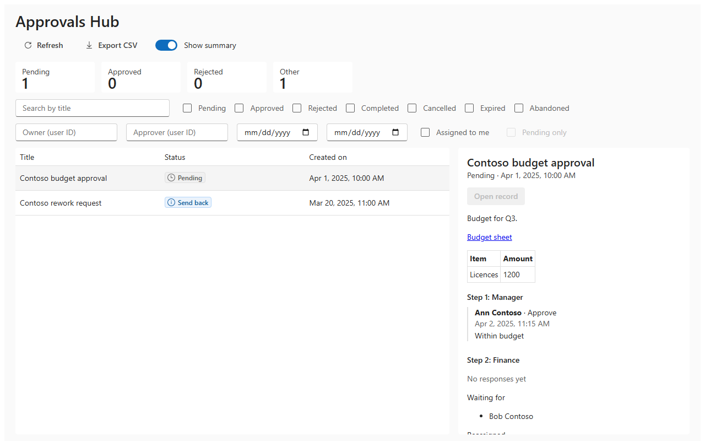

# Approvals Hub

Approvals Hub is a read-only page inside a Power Platform model-driven app. It lists the Power Automate approvals stored in Dataverse, shows their Approval Responses and Approval Steps, and lets you open the Regarding Record each Approval is about. It knows nothing about what the approvals are for: it shows what Dataverse holds and nothing more.





The screenshots use the synthetic `multiStep` scenario of the local mock client, not real data.

## Requirements

- A Dataverse environment with Power Automate approvals (the `msdyn_flow_approval` tables) and a model-driven app to host the page.
- Users see what their own Dataverse security roles allow. Approvals Hub adds no roles of its own (see [Known limitations](#known-limitations)).
- To build from source: Node.js 22 and npm, plus the Power Platform CLI (`pac`) to pack the solution.
- A current evergreen browser.

## Installing the solution

The Dataverse solution `ApprovalsHub` (publisher prefix `bpt`) contains the page as a web resource, the model-driven app **Approvals Hub** and the environment variable `bpt_ApprovalsHubConfig`.

1. Download `ApprovalsHub_<version>_managed.zip` from the [latest GitHub Release](../../releases/latest). Use the `_unmanaged` zip only in a development environment.
2. In Power Apps, open **Solutions**, choose **Import solution**, select the zip and finish the import.
3. Optional: set the current value of the environment variable `bpt_ApprovalsHubConfig` to your own configuration. Without one, the default value applies: `{"profiles":{"default":{"defaultStatus":"pending","columns":["title","status","createdOn","owner","currentStep","lastDecision"]}}}`. Its format is described in [Writing a Profile](#writing-a-profile).
4. Open the **Approvals Hub** app. Its single menu entry points at `$webresource:bpt_/approvalshub/index.html?data=profile%3Ddefault`.

## Adding a menu entry with a Profile to an existing app

A menu entry opens the same page with a chosen Profile. The Profile name goes in the entry's `data` parameter, written as `profile%3D<name>`. In the sitemap XML of an app module, an entry for a Profile named `category-a` looks like this:

```xml
<SubArea Id="subarea_category_a" Url="$webresource:bpt_/approvalshub/index.html?data=profile%3Dcategory-a" Client="All" PassParams="false" AvailableOffline="false">
  <Titles>
    <Title LCID="1033" Title="Category A approvals" />
  </Titles>
</SubArea>
```

In the app designer, add a web resource page for `bpt_/approvalshub/index.html` and give it the same `data` value. The Profile name must exist in the configuration. If it does not, the page shows a notice and uses `default`.

## Writing a Profile

The configuration value is one JSON object with a `profiles` map. Each key is a Profile name; `default` is used when no name is given. Unknown keys are rejected.

| Setting | Meaning |
| --- | --- |
| `extends` | Name of another Profile to inherit from. Settings merge field by field and the child wins. Cycles and unknown parents are errors. |
| `pageTitle` | Title shown on the page. Without it, the translated built-in title is used. |
| `scope` | The Profile Scope: a fixed filter users cannot remove. Criteria are `title` (`mode` of `equals`, `startsWith` or `contains`, plus `value`), `category` (exact match) and `tags` (contains). When a Profile extends another, scope criteria merge key by key. |
| `pageSize` | Approvals per server page, from 1 to 500. Default 100. |
| `defaultStatus` | Status filter used when the URL has no `status` parameter: `pending`, `approved`, `rejected`, `completed`, `cancelled`, `expired`, `abandoned`, or `null` for no default. Default `pending`. |
| `columns` | Columns to show, in order: any of `title`, `status`, `createdOn`, `owner`, `currentStep` (the Approval Step the Approval is at) and `lastDecision` (who answered last and when). Default all six. Every column except `lastDecision` can be sorted by clicking its header; users can resize all of them. |
| `accentColor` | Brand colour as `#rrggbb`, or `null` for the default. |

Scope criteria are ANDed with each other and with the title search and the status filter. Matching is case-insensitive.

A complete example with three Profiles, using generic names:

```json
{
  "profiles": {
    "default": {
      "defaultStatus": "pending"
    },
    "category-a": {
      "pageTitle": "Category A approvals",
      "pageSize": 50,
      "accentColor": "#107c10",
      "scope": { "category": "Category A" }
    },
    "category-b": {
      "extends": "category-a",
      "pageTitle": "Category B approvals",
      "accentColor": "#8e562e",
      "defaultStatus": "approved",
      "columns": ["title", "status"],
      "scope": { "category": "Category B" }
    }
  }
}
```

A Profile that matches only titles starting with a prefix uses the `title` criterion:

```json
{
  "profiles": {
    "expenses": {
      "pageTitle": "Expense approvals",
      "scope": { "title": { "mode": "startsWith", "value": "Expense" } }
    }
  }
}
```

If the configuration is invalid (bad JSON, a schema error, an `extends` cycle, an unknown parent, or a failure to read the value), the page shows an alert with the reason and uses the built-in defaults. Correct the value and reload the page.

## Setting the item link so Open record works

**Open record** opens the Regarding Record: the Dataverse record the Approval is about. The page looks for it in this order:

1. The flow's **item link** (`msdyn_flow_approval_itemlink`). Set the item link in the flow's approval action to a Dataverse record URL, for example:

   ```text
   https://contoso.crm.example.com/main.aspx?pagetype=entityrecord&etn=account&id=00000000-0000-0000-0000-0000000000a1
   ```

   The URL needs `etn` (the entity logical name) and `id` (a GUID, with or without braces).
2. If the item link is missing or is not a record link, the first record link in the Approval's details. Markdown links, HTML anchors and bare URLs all count, as long as the link has an `etn` parameter. Links without `etn` are ignored.

If the first record link has an empty or invalid `id`, no Regarding Record is found and later links are not tried. Open record only works inside the model-driven app. Outside it, the page shows "Could not open the record".

## Local development and scenarios

```bash
npm ci
npm run dev
```

Open `http://localhost:5173/?scenario=default&lang=en`. Without a hosting Xrm the page uses a local mock client with synthetic data. These query parameters control it:

| Parameter | Values | Effect |
| --- | --- | --- |
| `scenario` | `default`, `multiStep`, `longList`, `statuses`, `scoped`, `currentUserIsApprover`, `currentUserNotApprover`, `noRegarding`, `empty`, `noPermission`, `serverError`, `slow` | Synthetic Approvals for the mock client. Unknown values fall back to `default`. `longList` has 5000 Approvals; `empty` has none; `noPermission` answers every request as forbidden; `serverError` fails the first list request so the Retry button can be tried; `slow` delays each response by 1.5 seconds. |
| `client` | `fakeXrm` | Runs the real Dataverse client against an in-memory fake seeded with the scenario and a synthetic configuration with the Profiles `default`, `purchasing` and `travel`. |
| `profile` | a Profile name | Selects the Profile locally. In the solution, the web resource `data` parameter does this instead. |
| `lang` | `en`, `pl` | Interface language. Without it the page follows the user's Dataverse language: Polish for 1045, English otherwise. Dates always show in the user's Dataverse time zone. |
| `theme` | `light`, `dark` | Colour theme. Without it, the system preference applies. |

With `client=fakeXrm`, the page runs the same data code as in Dataverse, so it is the closest local check. For local clients, Open record is recorded in `window.__openedRecords()` instead of opening a form.

Before a pull request, run `npm run check`. It runs lint, typecheck, the unit tests (including the README examples), the leak check and the packaging tests. End-to-end tests run with `npm run test:e2e` after `npx playwright install chromium`.

## Solution and release

The Dataverse solution `ApprovalsHub` lives unpacked in `solution/src`. `scripts/build-solution.ps1` (or `scripts/build-solution.sh`) builds the page, copies it into the solution and packs `out/ApprovalsHub_<version>_managed.zip` and `_unmanaged.zip` with `pac`. The solution version must equal the `package.json` version (checked by `npm run check`). release-please keeps both in step, and the release workflow attaches the zips to the GitHub Release.

## Known limitations

- **Read-only.** Approvals Hub lists Approvals and their Approval Responses. It cannot approve or reject, and it does not link to a place where you can respond.
- **Regarding Record depends on flow links.** The record is found only if the flow sets an item link or puts a record link in the details. Approvals without one show no record.
- **Visibility follows the user's own roles.** The page shows exactly what the signed-in user's Dataverse roles let them read. An Approval is owned by the flow's connection user, not by its Approvers, so an Approver may not see an Approval they were asked to decide unless the platform shares it with them. Approvals Hub does not add roles yet.
- **Owner and Approver filters take user IDs.** They accept a user GUID; there is no user lookup.

## Licence and warranty

Approvals Hub is released under the MIT licence (see [LICENSE](LICENSE)).

The software is provided "as is", without warranty of any kind, express or implied, including but not limited to the warranties of merchantability, fitness for a particular purpose and non-infringement. In no event shall the authors be liable for any claim, damages or other liability arising from, out of or in connection with the software or its use.
